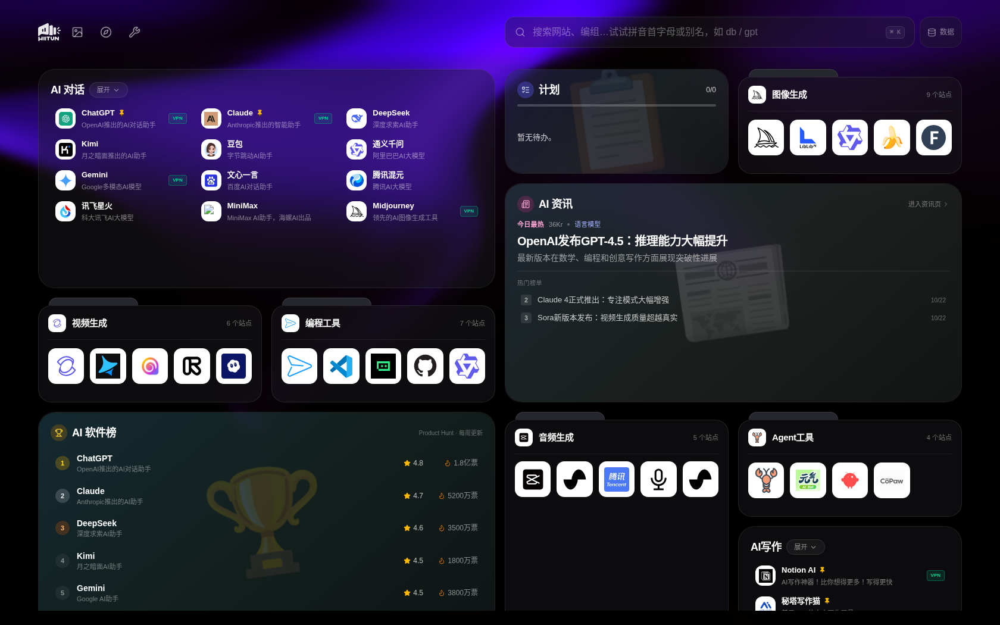

# 杂盒 ZaBox

一个**本地优先**的个人杂盒：把你常用的网站、每日资讯、任务计划和日程，统统收进一个可以自由拖拽排版的新标签页——杂，而有序。

在线体验：<https://news.hiitun01.top>



- **没有账号，不上传你的数据**：编组、站点、计划、设置全部只存在你自己的浏览器里，同步靠你自己的文件或你自己的 GitHub 仓库。
- **为"网站一多就找不到"而做**：编组 + 拼音搜索 + 自由排版，几百个站点也能一眼定位。

## 功能一览

**网站编组（核心）**

- 两种编组形态：**详细列表**（图标 + 名称 + 说明，可展开看全量）与**文件夹式**（图标瓷砖堆叠卡），随时一键互换
- **组合卡**：把两张文件夹卡合并成一张双 tab 卡（拖拽 2 秒"充能"后压到另一张卡上合并，或在空白处右键新建组合；tab 可拖出解组）
- 站点管理：置顶、标签（1–4 个英文字母，如 `VPN`）、右键菜单编辑/删除、名称与说明字数上限
- 卡片自由拖拽排序，右键调整宽度（1/2 栏）与高度（1x/2x）

**搜索**：顶部搜索框支持中文、**拼音首字母**（输入 `db` 找豆包）与别名直达，下拉即时预览并可回车打开

**计划任务小工具**

- **待办**：勾选完成、分组（把相关的事收成一组）、已完成折叠
- **长期计划**：按次数推进（健身打卡 12/30 次，点 +1）或按截止日期（显示剩余天数、逾期提醒）
- **AI 整理**：把一句杂事（"下周交设计稿，还想练吉他，顺便把桌面整理了"）自动拆成待办与计划，确认后落库；当前为本地规则拆分，不联网、不需要 Key

**资讯组件**：AI 资讯（36Kr / 量子位 RSS）、热门话题、AI 软件排行榜（数据来自 Product Hunt，GitHub Actions 每周自动更新）

**文件工具**：PDF 转图片、PDF 转长图、PDF 转 TXT、图片转 PDF、PDF 合并与拆分——全部在浏览器本地完成，文件不上传服务器

**外观**：深色氛围背景，可切换预设底色，也可上传本地图片作背景（图片只存本机浏览器，不上传）

## 部署

### 方式一：Vercel（推荐，零配置）

1. Fork 本仓库
2. 在 [Vercel](https://vercel.com/new) 导入你 Fork 的仓库，框架选 Vite（仓库已带 `vercel.json`，构建命令与输出目录都配好了）
3. 部署完成即得到一个可用站点：根目录 `api/` 下的函数会提供资讯/话题/榜单接口，`vercel.json` 里的 Cron 会每天定时预热资讯接口

不需要任何环境变量即可完整运行。排行榜数据由 `.github/workflows/update-ranking.yml` 每周一自动刷新并提交回仓库（在 Fork 的仓库里启用 Actions 即可；如需真实 Product Hunt 数据，在仓库 Secrets 里加 `PRODUCT_HUNT_TOKEN`，不加则使用内置备用数据）。

### 方式二：本地运行 / 自有服务器

```bash
npm install
npm run dev        # 开发服务器，http://localhost:3000
npm run server     # 资讯接口服务（可选，Express 实现，与 api/ 函数等价）
npm run build      # 构建到 dist/
npm run lint       # 类型检查
```

构建出的 `dist/` 是纯静态文件，可托管到任意静态服务（Nginx、GitHub Pages、Cloudflare Pages 等）。注意：资讯、热门话题、软件榜三个组件依赖 `/api` 接口；纯静态托管时这三个组件无数据，但导航、搜索、计划、同步等本地功能全部正常。

### 可选环境变量

复制 `.env.example` 为 `.env.local`，填入 `GEMINI_API_KEY` 后可启用预留的 AI 增强功能；不填不影响任何基础功能。

## 数据与同步

**本地优先**：所有个人数据只保存在浏览器 `localStorage`，服务端不保存、不收集任何用户数据。换浏览器或清缓存会回到初始数据，请用下面的方式备份/同步。

在页面右上角「数据」菜单里，有四种方式（可叠加使用）：

| 方式 | 说明 | 门槛 |
| --- | --- | --- |
| 导出 / 导入 JSON | 一键把全部数据导出为一个 JSON 文件，换设备时导入即可恢复 | 无 |
| 本地文件保存 | 指定一个本地 JSON 文件，数据变化后自动写回（也支持手动点保存） | Chrome / Edge（File System Access API）；其他浏览器退化为下载 |
| GitHub 同步 | 把数据存进你自己的一个私有 GitHub 仓库，多设备自动拉取/写回 | GitHub 账号（点一次登录授权） |
| 恢复默认 | 回到内置初始数据 | 无 |

### GitHub 同步设置（点一次登录）

1. 打开本站「数据 → GitHub 同步」，点「使用 GitHub 登录」
2. 在 GitHub 官方授权页确认授权（本站走 OAuth 登录，不接触你的 GitHub 密码，不用生成、粘贴任何令牌）
3. 登录成功后，会自动在你的账号下创建一个**私有**仓库 `ainav-data` 并开启同步：每次打开页面自动拉取最新数据，你的修改会在几秒后自动写回仓库（每次写回是一个 commit，历史可查可回滚）
4. 其他设备（手机、另一台电脑）打开同一站点，同样点一次 GitHub 登录即完成配对

**冲突处理**：两台设备同时改动时，按数据自带的更新时间裁决，较新的胜出；实在裁不下，菜单里会让你选「以云端为准」或「以本地为准」，不会静默丢数据。

**安全说明**：登录凭证只保存在你本机的浏览器里，不会进入同步的 JSON，也不会出现在导出文件里；同步仓库是你的私有仓库，你随时可以在 GitHub 设置里撤销本站的授权。

## 技术栈

React 19 + Vite 6 + TypeScript + Tailwind CSS 4；资讯接口为 Vercel Serverless Functions（根目录 `api/`），另有等价的 Express 实现（`server/`）供自托管；排行榜数据由 GitHub Actions 每周更新。

## 路线图

- [ ] 栏位布局：卡片按 4 栏锚定排放，互不挤占（开发中）
- [x] GitHub OAuth 登录同步（免令牌）
- [ ] 小组件专属渐变底色
- [ ] 浏览器新标签页扩展（Chrome / Edge）
- [ ] WebDAV 同步适配器

## 参与贡献

杂盒欢迎大家一起添砖加瓦，主要有四种方式（详细规则见 [CONTRIBUTING.md](CONTRIBUTING.md)）：

- **小工具**：给文件工具页加一个新工具，或改进现有工具——先开 Issue 说说想做什么，对齐后再写代码
- **视觉效果**：新的背景预设、动态效果、卡片视觉点子，附一张截图就能聊
- **网站收录**：发现好网站想让它进内置导航？用「推荐网站收录」Issue 模板填一下就行，**不会写代码也能参与**
- **代码优化**：性能、重构、修 Bug 这类不改变功能和外观的改进，直接欢迎

也先把话说在前面：**主页布局与卡片体系、产品定位、本地优先的数据架构、开源协议这些"大方向"由维护者把控**，不接受改变方向的 PR——不是摆架子，是怕你辛苦写完却合不进来。拿不准算不算方向类改动，先开 Issue 聊一句，不吃亏。

## 维护者与许可证

由 [@0waitgoo](https://github.com/0waitgoo) 创建并维护。欢迎 Issue 与 Pull Request，参与前请先读 [CONTRIBUTING.md](CONTRIBUTING.md)。

维护者平时较少上 GitHub，不过 Issue 与 PR 都有人跟进、不会石沉大海；如需直接联系维护者：微信 **waitgoo** · 邮箱 **379941321@qq.com**。

本项目采用 [MIT](https://opensource.org/licenses/MIT) 授权：可以自由使用、复制、修改、合并、发布、分发、再授权及**商用**，只需保留版权与许可声明。完整法律文本见 [LICENSE](LICENSE)。
